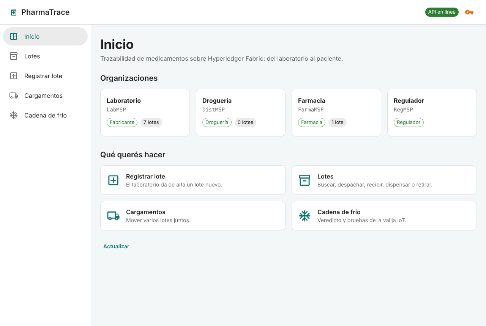
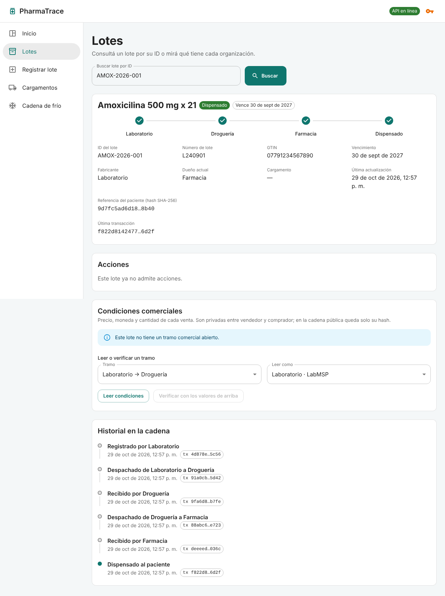
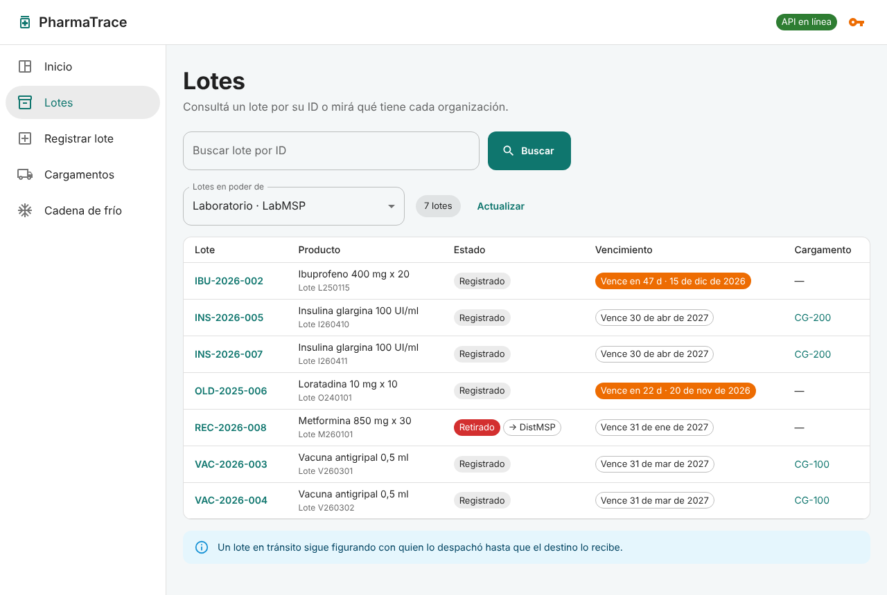
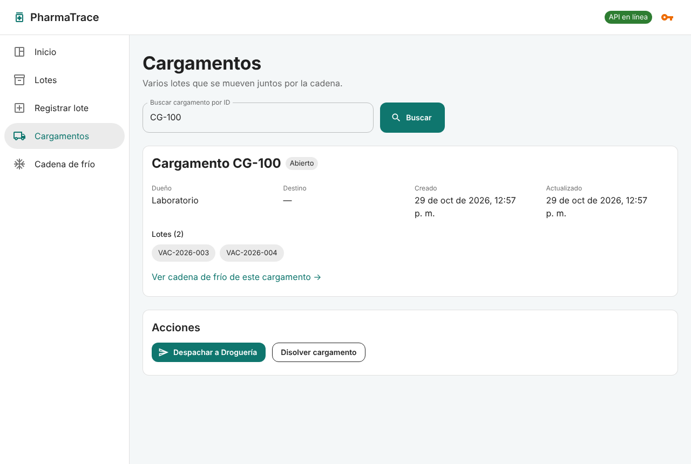
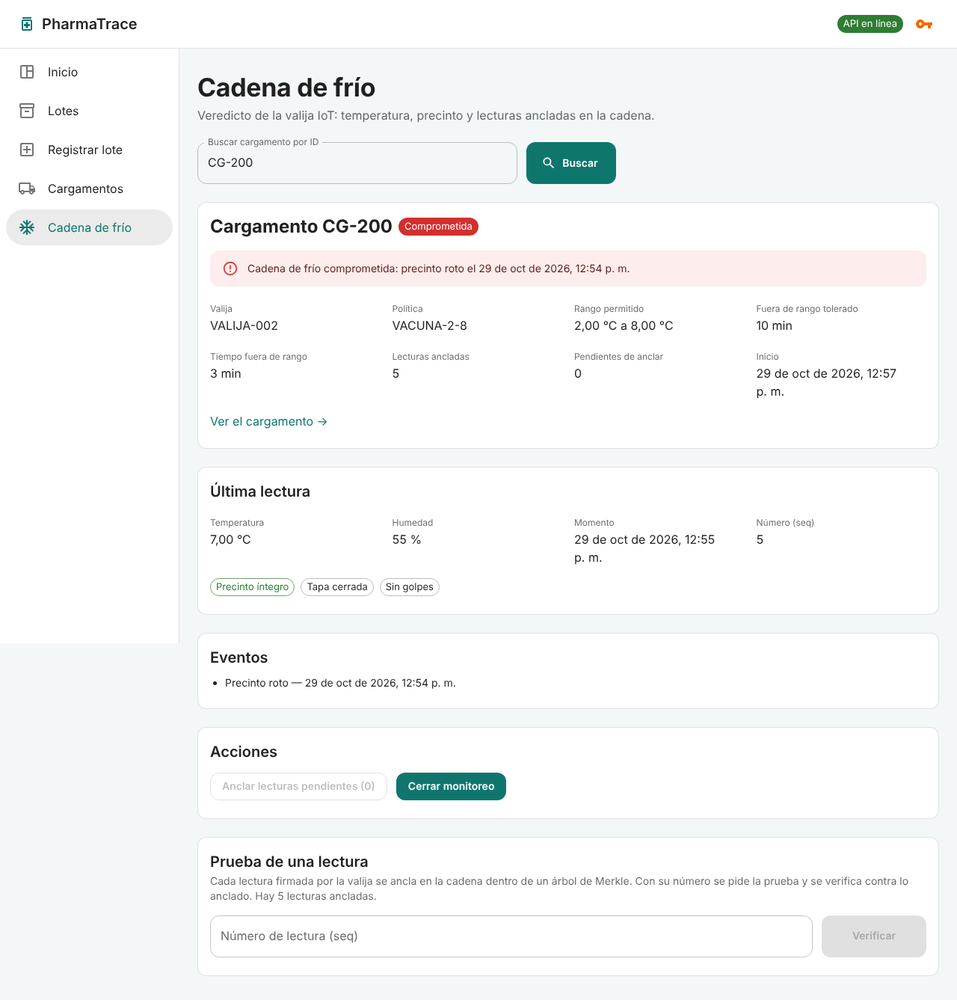
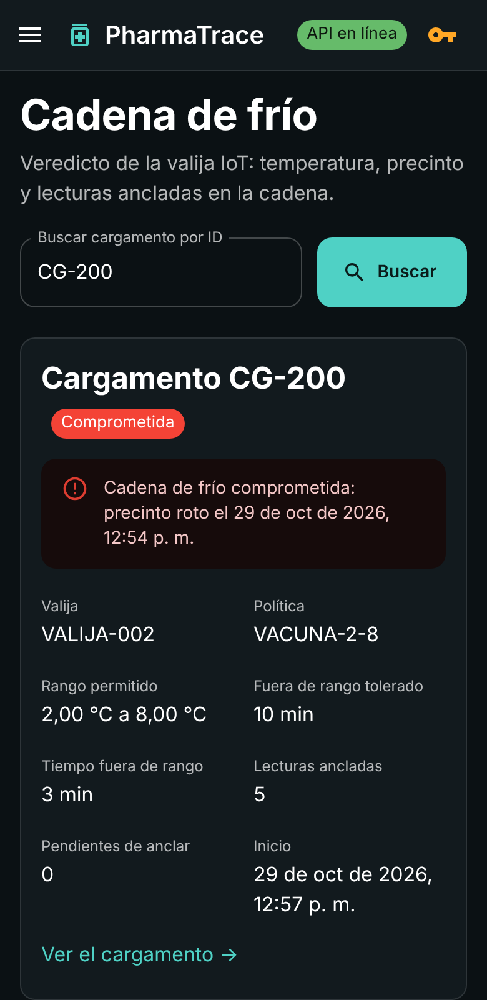

# PharmaTrace UI

[🇪🇸 Español](README.es.md) · 🇬🇧 English

Web interface for [PharmaTrace](https://github.com/gastonhp1/PharmaTrace) on **Hyperledger Fabric**
(React + Vite + MUI). It only talks to the backend's REST API (`backend/` in the main repo); it never
connects to the Fabric network or handles identities. The backend is custodial: it signs every
operation with the identity of the organization that has to act (the batch owner, the recipient, the
regulator).



## What you can do

| Screen | Route | What it does |
| --- | --- | --- |
| Home | `/` | Consortium organizations, their role and how many batches each one holds |
| Batches | `/batches/:batchId?` | Look up a batch or list an organization's batches; dispatch, receive, dispense, recall; commercial terms; on-chain history |
| Register batch | `/register` | The manufacturer registers a batch (8–14 digit GTIN, expiry date) |
| Cargoes | `/cargo/:cargoId?` | Group several batches into a cargo, dispatch, receive or dissolve it |
| Cold chain | `/coldchain/:cargoId?` | IoT case verdict, last reading, events and a Merkle proof for each reading; operator setup |

A batch that went through the whole chain, with its transaction history:



Batches held by an organization, with expiry warnings and recalled batches:



Cargoes (batches move together) and the cold chain with the case's verdict:





On mobile and in dark mode (follows the system theme):



> Screenshots were taken against the real Express backend with a **simulated ledger** (the chaincode
> rules rewritten in JS) and demo data, not against a running Fabric network.

## Running it

```bash
npm install
cp .env.example .env     # and set VITE_API_URL if the API is not on :3001
npm run dev              # http://localhost:5173
```

With the Fabric network and the backend up (see `fabric/` and `backend/` in the main repo).

### API key

The backend requires the `x-api-key` header on every write (and to read commercial terms, which are
private). The UI **does not ship the key in the bundle**: you enter it at runtime with the key button
in the top bar and it lives only in that tab (`sessionStorage`). Without a key only writes fail, with
the message "La clave de API falta o es incorrecta" (the API key is missing or wrong).

### Variables (`.env`)

| Variable | Purpose |
| --- | --- |
| `VITE_API_URL` | API URL (defaults to `http://localhost:3001`). In the Docker image it is `/`: the API on the same origin, behind the ingress. |
| `VITE_API_KEY` | Optional, local development only: default value for the key. Every `VITE_*` value is visible in the bundle; leave it empty in real deployments. |

## Rules the UI follows

The chaincode enforces them; the UI only shows what makes sense and translates the errors.

- **Chain of custody:** Laboratory → Distributor → Pharmacy. Each dispatch goes to the next role and
  the batch stays *in transit* until the destination receives it. A batch in transit still shows up
  under whoever dispatched it.
- **Batch states:** Registered → In transit → At distributor → At pharmacy → Dispensed. A recall is
  signed by the regulator and is final; a recalled batch in transit still has to be received to close
  the transit.
- **Cargoes:** the batches in a cargo are dispatched and received together; a single batch of a cargo
  cannot move on its own. A cargo with a recalled batch cannot be dispatched: dissolve it and leave
  the batch out.
- **Dispensing:** the backend stores only the SHA-256 hash of the patient reference, never the value.
- **Commercial terms** (price, currency, quantity): kept in private data collections. Only the seller
  and buyer of each leg can read them; anyone can check whether some values match the public hash
  without seeing the real ones.
- **Cold chain:** the case signs each reading (P-256); readings are anchored in windows under a Merkle
  root. The verdict goes from *Monitoring* to *Compliant* or *Compromised* (broken seal, or more time
  out of range than the policy tolerates) and is final once monitoring is closed.

## Structure

```
src/
├── api.js              API client: errors as exceptions with Spanish messages
├── errorMessages.js    Translates chaincode and backend errors
├── apiKey.js           Runtime API key (sessionStorage)
├── domain.js           Organizations, states, possible actions and formatting
├── hooks/useAction.js  { loading, error, data } for each call
├── components/         Layout, CustodyStepper, BatchActions, TermsPanel, BatchHistory, ...
└── pages/              Dashboard, Batches, Register, Cargo, ColdChain
```

The interface itself is in Spanish.

## Scripts

`npm run dev` · `npm run build` · `npm run preview` · `npm run lint`

## Testing status

The UI was tested end to end with Playwright (29 flows: full batch lifecycle, recall, cargoes, private
terms, cold chain, translated errors, API down, mobile) against the real Express backend with a
simulated ledger. It was **not** tested against a real Fabric network or the Go chaincode:
endorsement policies and MSP identities remain uncovered until the network is available.
